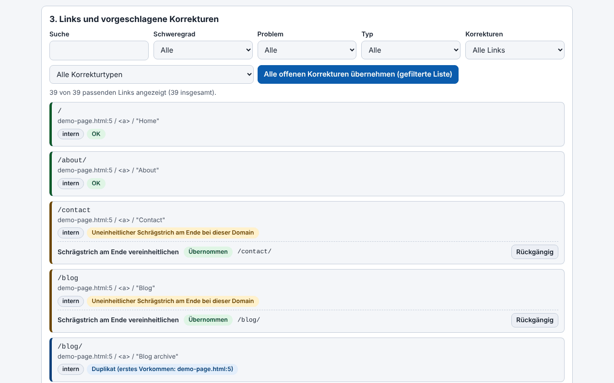

# Trade-Free Link Guardian

[English](README.md) · [Română](README.ro.md) · [Français](README.fr.md) · [Italiano](README.it.md) · [Español](README.es.md) · [Português](README.pt.md) · **Deutsch** · [Magyar](README.hu.md)

**Version:** 1.35.0 · **Zuletzt aktualisiert:** 2026-10-19

Oberflächensprachen: **Română, English, Français, Italiano, Español, Português (PT), Deutsch, Magyar**

> **Zwei Varianten:** das WordPress-Plugin (die Datei `trade-free-link-guardian.php`) und eine **Single-File-Web-App** (`index.html`), die im Browser läuft, offline, ohne WordPress: **[Online](https://chiuta.github.io/Trade-Free-Link-Guardian/)**.

## Die Web-App (`index.html`)

Du fügst HTML, Markdown, Text, einen WXR-Export oder eine Sitemap ein oder lädst sie hoch und erhältst: die extrahierten und klassifizierten Links, offline erkannte Probleme (http, Tracking-Parameter, www/non-www, Duplikate, fehlerhafte Adressen), deterministische Korrekturen mit Rückgängig-Funktion, das korrigierte Dokument, CSV-Export (mit Schutz vor Formelinjektion) und JSON sowie einen druckbaren Bericht. Rumänisch und Englisch; Tastenkürzel. Sie stellt keine Netzwerkanfragen und hat kein Tracking, keine Cookies oder Konten. Sie prüft nicht, ob externe Links antworten (der Browser erlaubt das nicht zuverlässig) — nutze dafür das Plugin.

Ein WordPress-Plugin, das tote Links in Beiträgen, Seiten, Menüs und Widgets findet und alles, was sich reparieren lässt, deterministisch repariert — es läuft auf deinem Server, ohne SaaS-Konto und ohne Telemetrie.

## Was es ist

Ein lokaler Link-Prüfer. Interne Links werden strukturell geprüft (Datenbank und Dateisystem), externe über eine HTTP-Anfrage, die dein Server direkt an das Ziel des Links sendet. Das Plugin ist eine einzige PHP-Datei (`trade-free-link-guardian.php`), ohne Build-Schritt und ohne mitgelieferte Abhängigkeiten — die Philosophie „ohne Grenzen“ / trade-free.

## Funktionen (im Code geprüft)

- Scannen: Beiträge, Seiten und ausgewählte öffentliche Inhaltstypen, klassische und Block-Menüs, Widgets, optional Bilder; Extraktion sowohl aus dem HTML als auch aus den Block-Attributen.
- Prüfung: HEAD mit Rückfall auf GET `Range: bytes=0-0`; Weiterleitungen werden Schritt für Schritt verfolgt (max. 5), wobei dauerhafte (301/308) von temporären unterschieden werden; gleichzeitige Prüfungen (standardmäßig 20); eine eindeutige URL wird pro Scan nur einmal geprüft.
- Automatische Korrekturen (jede in den Einstellungen schaltbar): `http`→`https`, Umschalten von `www.`, dauerhafte Weiterleitung bis zum endgültigen Ziel verfolgt, umbenannter Slug (`_wp_old_slug`), weitere deterministische Muster.
- Manuelle Korrekturen: URL ersetzen, Link entfernen (Text/Bild bleibt erhalten), Wiederherstellen aus dem Papierkorb, Notiz, Ignorieren.
- Korrekturprotokoll mit Rückgängig-Funktion (Ausnahme: Das Entfernen des Links wird nicht automatisch rückgängig gemacht); ein „Vorschlagsbericht“, der nichts verändert.
- 404-Monitor und lokale Weiterleitungsregeln 301/302/410 (exakter Pfadabgleich).
- WP-Cron-Planung (aus/täglich/wöchentlich) mit Benachrichtigungs-E-Mail; Warnung im Editor bei Links, die bereits als tot bekannt sind.
- CSV-Export (mit Schutz vor Formelinjektion), druckbarer Konformitätsbericht, Multisite.
- Optional, standardmäßig deaktiviert: Erkennung von Inhalts-„Drift“, Suche in der Wayback Machine, Links zu archive.today und Memento.

## Anleitung

1. Kopiere den Ordner nach `wp-content/plugins/` (oder installiere das Archiv über **Plugins → Installieren → Hochladen**) und aktiviere ihn.
2. **Link Guardian → Einstellungen**: Wähle die Inhaltstypen und welche automatischen Korrekturen erlaubt sind.
3. **Link Guardian → Dashboard → Jetzt scannen**.
4. Filtere unter **Links** nach „Defekt“; in jeder Zeile: Erneut prüfen, Automatisch korrigieren, URL bearbeiten, Link entfernen, Ignorieren.
5. Nutze vor Massenkorrekturen den Vorschlagsbericht; danach kannst du im **Korrekturprotokoll** rückgängig machen.
6. Erstelle vor den ersten Massenkorrekturen eine Sicherung der Datenbank.

## Datenschutz und Netzwerk

- Die einzigen ausgehenden HTTP-Anfragen: (1) die Prüfung der Links in deinen eigenen Inhalten (einschließlich des optionalen Drifts, der höchstens 1 MiB der Seite herunterlädt); (2) optional `archive.org/wayback/available?url=...` beim Klick auf „Archivierte Version finden“, nur wenn die Einstellung aktiv ist. Die Links zu archive.today / Memento / Buy Me a Coffee sind einfache Links, die dein Browser beim Klick öffnet.
- Es gibt keine eigenen Updates, keine Analytics, Lizenzen oder „Phone-home“-Aufrufe.
- **User-Agent:** Standardmäßig sendet das Plugin einen Chrome-Browser-User-Agent (einstellbar), keinen, der es identifiziert; die Ziele erfahren den Namen deiner Website nicht aus dem Header. In den Einstellungen kannst du einen ehrlichen setzen, der Form `TradeFreeLinkGuardian/x.y (+site)`.
- Der **404-Monitor** läuft bei den Anfragen von Besuchenden, die auf einer 404 landen, und speichert standardmäßig den angefragten Pfad, den Referer-Header (falls vorhanden) und einen Bot/Mensch-Indikator; die IP wird nicht gespeichert. Er wird nach 60 Tagen gelöscht und lässt sich in den Einstellungen abschalten. Wenn du Besuchende in der EU hast, erwähne ihn in der Datenschutzerklärung.
- Die Deinstallation (Löschen unter Plugins) entfernt die erstellten Tabellen, Optionen und Transients.

## Grenzen und Warnhinweise

- Das Plugin **verändert echte Inhalte** (`post_content`, Widgets, Menüs). Erstelle Sicherungen. Das Entfernen eines Links wird nicht automatisch rückgängig gemacht; bei einem klassischen Menüeintrag **löscht** das Entfernen den Eintrag **endgültig**.
- Die Korrektur „dauerhafte Weiterleitung“ schreibt den Link auf das Ziel um, zu dem die Weiterleitung einer Drittseite führt; wurde diese Seite von jemand anderem übernommen, folgt dein Link dem neuen Ziel. Deaktiviere die Option, wenn du dieses Risiko nicht möchtest.
- Ein 403 bedeutet oft Bot-Blockierung, nicht einen toten Link.
- Versionen vor 1.33.1 konnten Backslashes aus dem Inhalt von durch Korrekturen geänderten Beiträgen löschen; bei betroffenen Beiträgen nutze die WordPress-Revisionen.
- Nur durch Codeanalyse und `php -l` getestet; im Rahmen dieses Audits wurde es nicht auf einer WordPress-Installation ausgeführt.
- Die Oberfläche hat 8 Sprachen (RO, EN, FR, IT, ES, PT, DE, HU), die über eine Auswahl gewählt werden (standardmäßig die Browsersprache, sonst Englisch; die Wahl wird nicht gespeichert, im Sinne des Trade-Free-Prinzips).

## Lokal ausführen

Es gibt keinen Build. Für die Entwicklung: `wp-content/plugins/trade-free-link-guardian/` + eine lokale WordPress-Instanz. Siehe `CONTRIBUTING.md`. Der Ordner `.wordpress-org/` enthält die Icons und Banner für das WordPress.org-Verzeichnis.

## Verlauf / Changelog

### 1.34.0 — 2026-10-14
- Datensicherung und Datenkennzeichnung (fff-kit).

### web 1.33.5 — 12. Oktober 2026
- Die Version und das Datum der letzten Aktualisierung werden in der App angezeigt (Fußzeile); das Plugin bleibt bei 1.33.1, unangetastet.

### web 1.33.4 — 11. Oktober 2026
- Web-App: Falsche Schemata wie `htp:/bad` (mit nur einem Schrägstrich) werden jetzt als fehlerhafte URL markiert; neue Prüfungen: `http:example.com` (ohne Schrägstriche, mit Reparatur zu `http://example.com`) und Port außerhalb des Bereichs 0–65535.
- CSP-Hash des Skripts neu berechnet; das Plugin bleibt bei 1.33.1, unangetastet.

### web 1.33.3 — 11. Oktober 2026
- Web-App: Tastenkürzel (Strg+Enter im Textfeld analysiert den eingefügten Text; „/“ setzt den Fokus auf den Ergebnisfilter), mit Hinweis in der Oberfläche (Rumänisch und Englisch); beachtet `prefers-reduced-motion`.
- Korrigiert: Die im Kopf angezeigte Version, die in den Exporten (`version` im JSON) und die im README stimmen jetzt überein (1.33.3-web); das Plugin bleibt bei 1.33.1, unangetastet.

### web 1.33.2 — 11. Oktober 2026
- Web-App: neue Korrektur „Fehlerhaftes Schema reparieren“ (http// → http://, http:/, http;//, htps://, http:///, doppeltes Schema); der Link „http//bad“ wird jetzt beim Schema repariert, bleibt aber als ohne TLD markiert.
- CSP-Hash des Skripts neu berechnet; Web-App-Version 1.33.2 (das Plugin bleibt bei 1.33.1, unangetastet).

## Lizenz

MIT (siehe `LICENSE`).

## Autor

Alexio — Alexandru-Ionuț Chiuță · Kontakt: alexio@trom.tf · https://trom.tf/

## Zusammenfassung
Ein selbst gehosteter WordPress-Prüfer für defekte Links und deterministischer Link-Korrektor (eine einzige PHP-Datei, WordPress 6.5+, PHP 7.4+). Jede ausgehende Anfrage geht an einen Link in deinen eigenen Inhalten; der einzige optionale Aufruf bei Dritten ist eine Wayback-Machine-Abfrage, die du von Hand auslöst. Keine Telemetrie, kein SaaS. Version 1.33.1 behebt eine SSRF-Lücke im gleichzeitigen Prüfer und einen Fehler, der beim Umschreiben von Inhalten Backslashes entfernte. Es bearbeitet echte Beitragsinhalte: Erstelle Sicherungen.
