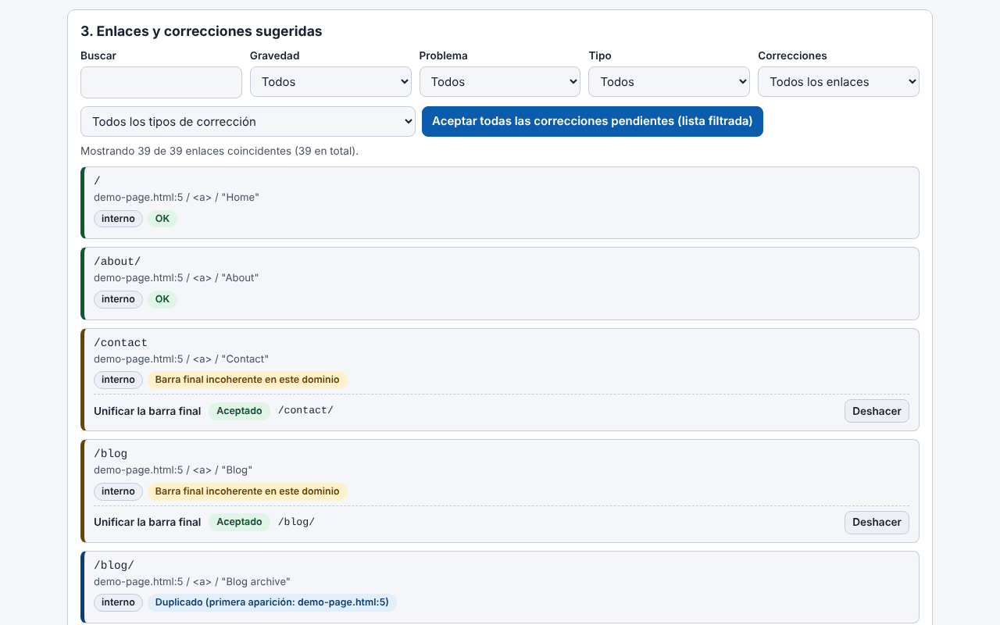

# Trade-Free Link Guardian

[English](README.md) · [Română](README.ro.md) · [Français](README.fr.md) · [Italiano](README.it.md) · **Español** · [Português](README.pt.md) · [Deutsch](README.de.md) · [Magyar](README.hu.md)

**Versión:** 2.1.0 · **Última actualización:** 2026-10-27

Idiomas de la interfaz: **Română, English, Français, Italiano, Español, Português (PT), Deutsch, Magyar**

> **Dos variantes:** el plugin de WordPress (el archivo `trade-free-link-guardian.php`) y una **aplicación web de un solo archivo** (`index.html`) que se ejecuta en el navegador, sin conexión, sin WordPress: **[En línea](https://chiuta.github.io/Trade-Free-Link-Guardian/)**.

## La aplicación web (`index.html`)

Pegas o cargas HTML, Markdown, texto, una exportación WXR o un sitemap y obtienes: los enlaces extraídos y clasificados, los problemas detectados sin conexión (http, parámetros de seguimiento, www/no-www, duplicados, direcciones mal formadas), correcciones deterministas con deshacer, el documento corregido, exportación CSV (con protección contra inyección de fórmulas) y JSON, además de un informe imprimible. Rumano e inglés; atajos de teclado. No hace ninguna solicitud de red y no tiene seguimiento, cookies ni cuentas. No comprueba si los enlaces externos responden (el navegador no lo permite de forma fiable) — para eso usa el plugin.

Plugin de WordPress que encuentra los enlaces muertos en entradas, páginas, menús y widgets y repara de forma determinista lo que se puede reparar — se ejecuta en tu servidor, sin cuenta SaaS y sin telemetría.

## Qué es

Un verificador de enlaces local. Los enlaces internos se comprueban estructuralmente (base de datos y sistema de archivos), los externos mediante una solicitud HTTP enviada directamente por tu servidor al destino del enlace. El plugin es un único archivo PHP (`trade-free-link-guardian.php`), sin paso de compilación y sin dependencias empaquetadas — la filosofía «sin fronteras» / trade-free.

## Funciones (verificadas en el código)

- Escaneo: entradas, páginas y tipos de contenido públicos elegidos, menús clásicos y de bloques, widgets, opcionalmente imágenes; extracción tanto del HTML como de los atributos de los bloques.
- Verificación: HEAD con respaldo a GET `Range: bytes=0-0`; redirecciones seguidas paso a paso (máx. 5), distinguiendo las permanentes (301/308) de las temporales; comprobaciones concurrentes (20 por defecto); una URL única se comprueba una sola vez por escaneo.
- Correcciones automáticas (cada una se puede activar en Ajustes): `http`→`https`, conmutación de `www.`, redirección permanente seguida hasta el destino final, slug renombrado (`_wp_old_slug`), otros patrones deterministas.
- Correcciones manuales: sustitución de URL, eliminación del enlace (se conserva el texto/la imagen), restauración desde la papelera, nota, ignorar.
- Registro de correcciones con deshacer (excepción: la eliminación del enlace no se deshace automáticamente); un «informe de propuestas» que no modifica nada.
- Monitor de 404 y reglas locales de redirección 301/302/410 (coincidencia exacta de la ruta).
- Programación con WP-Cron (desactivada/diaria/semanal) con correo de notificación; aviso en el editor para enlaces ya conocidos como muertos.
- Exportación CSV (con protección contra inyección de fórmulas), informe de conformidad imprimible, multisitio.
- Opcionales, desactivados por defecto: detección de «deriva» del contenido, búsqueda en la Wayback Machine, enlaces a archive.today y Memento.

## Manual de uso

1. Copia la carpeta en `wp-content/plugins/` (o instala el archivo desde **Plugins → Añadir nuevo → Subir**) y actívala.
2. **Link Guardian → Ajustes**: elige los tipos de contenido y qué correcciones automáticas se permiten.
3. **Link Guardian → Escritorio → Escanear ahora**.
4. En **Enlaces**, filtra por «Rotos»; en cada fila: Volver a comprobar, Corregir automáticamente, Editar URL, Quitar enlace, Ignorar.
5. Antes de las correcciones masivas, usa el informe de propuestas; después puedes deshacer desde **Registro de correcciones**.
6. Haz una copia de seguridad de la base de datos antes de las primeras correcciones masivas.

## Privacidad y red

- Las únicas solicitudes HTTP salientes: (1) la comprobación de los enlaces de tu propio contenido (incluida la deriva opcional, que descarga como máximo 1 MiB de la página); (2) opcionalmente, `archive.org/wayback/available?url=...` al hacer clic en «Buscar versión archivada», solo si el ajuste está activo. Los enlaces archive.today / Memento / Buy Me a Coffee son simples enlaces que abre tu navegador al hacer clic.
- No hay actualizaciones propias, analítica, licencias ni llamadas «phone-home».
- **User-Agent:** por defecto el plugin envía un User-Agent de navegador Chrome (ajuste editable), no uno que lo identifique; los destinos no conocen el nombre de tu sitio por la cabecera. Puedes fijar uno honesto, de la forma `TradeFreeLinkGuardian/x.y (+sitio)`, en Ajustes.
- El **monitor de 404** actúa sobre las solicitudes de los visitantes que llegan a un 404 y, por defecto, almacena la ruta solicitada, la cabecera Referer (si existe) y un indicador bot/humano; no almacena la IP. Se borra a los 60 días y se puede desactivar en Ajustes. Si tienes visitantes en la UE, menciónalo en la política de privacidad.
- La desinstalación (eliminar desde Plugins) borra las tablas, opciones y transitorios creados.

## Límites y advertencias

- El plugin **modifica contenido real** (`post_content`, widgets, menús). Haz copias de seguridad. La eliminación del enlace no se deshace automáticamente; para un elemento de menú clásico, la eliminación **borra definitivamente** el elemento.
- La corrección «redirección permanente» reescribe el enlace hacia donde lleva la redirección de un sitio de terceros; si ese sitio ha sido adquirido por otra persona, tu enlace sigue el nuevo destino. Desactiva la opción si no quieres este riesgo.
- Un 403 suele significar bloqueo de bots, no un enlace muerto.
- Las versiones anteriores a la 1.33.1 podían eliminar las barras invertidas del contenido de las entradas modificadas mediante correcciones; para las entradas afectadas usa las Revisiones de WordPress.
- Probado únicamente mediante análisis de código y `php -l`; no se ejecutó en una instalación de WordPress en esta auditoría.
- La interfaz tiene 8 idiomas (RO, EN, FR, IT, ES, PT, DE, HU), que se eligen en un selector (por defecto sigue el idioma del navegador, si no el inglés; la elección no se guarda, en línea con el principio trade-free).

## Ejecución local

No hay compilación. Para desarrollo: `wp-content/plugins/trade-free-link-guardian/` + una instancia local de WordPress. Véase [`CONTRIBUTING.es.md`](CONTRIBUTING.es.md). La carpeta `.wordpress-org/` contiene los iconos y banners para el directorio de WordPress.org.

## Historial / Changelog

### 1.36.4 — 2026-10-23
- Detección de hosts locales: `localhostile.com` o `10.ejemplo.es` ya no se tratan como locales (y ya no evitan el aviso «http, no https»); `localhost`, las direcciones IP y `*.local/.internal/.lan` siguen siendo locales.

### 1.36.2 — 2026-10-22
- fff-kit 1.1.4: objetivos táctiles y texto mínimo

### 1.36.1 — 2026-10-22
- fff-kit 1.1.2: PBKDF2 con 600.000 iteraciones, protección anti-clickjacking.

### 1.36.0 — 2026-10-22
- La herramienta web funciona ahora de verdad sin conexión: service worker real (cache-first con revalidación en segundo plano), manifiesto PWA e iconos; se puede instalar cuando se sirve por https. El archivo sigue funcionando solo desde file://.
- Etiqueta de transparencia corregida: el ejemplo de demostración ya no aparece como un falso host externo (egress vacío); se declara serviceWorker y se listan los 8 idiomas de la interfaz.

### 1.34.0 — 2026-10-14
- Copia de seguridad y etiquetado de datos (fff-kit).

### web 1.33.5 — 12 de octubre de 2026
- La versión y la fecha de la última actualización se muestran en la aplicación (pie de página); el plugin sigue en 1.33.1, sin cambios.

### web 1.33.4 — 11 de octubre de 2026
- Aplicación web: los esquemas erróneos como `htp:/bad` (con una sola barra) se marcan ahora como URL mal formada; nuevas comprobaciones: `http:example.com` (sin barras, con reparación a `http://example.com`) y puerto fuera del intervalo 0–65535.
- Hash CSP del script recalculado; el plugin sigue en 1.33.1, sin cambios.

### web 1.33.3 — 11 de octubre de 2026
- Aplicación web: atajos de teclado (Ctrl+Intro en el cuadro de texto analiza el texto pegado; «/» mueve el foco al filtro de resultados), con una indicación en la interfaz (rumano e inglés); respeta `prefers-reduced-motion`.
- Corregido: la versión mostrada en la cabecera, la de las exportaciones (`version` en el JSON) y la del README coinciden ahora (1.33.3-web); el plugin sigue en 1.33.1, sin cambios.

### web 1.33.2 — 11 de octubre de 2026
- Aplicación web: nueva corrección «Reparar el esquema mal formado» (http// → http://, http:/, http;//, htps://, http:///, esquema duplicado); el enlace «http//bad» se repara ahora en el esquema, aunque sigue marcado como sin TLD.
- Hash CSP del script recalculado; versión de la aplicación web 1.33.2 (el plugin sigue en 1.33.1, sin cambios).

## Licencia

MIT (véase `LICENSE`).

## Autor

Alexio — Alexandru-Ionuț Chiuță · contacto: alexio@trom.tf · https://trom.tf/

## Resumen

Un verificador de enlaces rotos para WordPress autoalojado y corrector determinista de enlaces (un solo archivo PHP, WordPress 6.5+, PHP 7.4+). Toda solicitud saliente va a un enlace de tu propio contenido; la única llamada opcional a terceros es una consulta a la Wayback Machine que activas a mano. Sin telemetría, sin SaaS. La versión 1.33.1 corrige un fallo SSRF en el verificador concurrente y un error de eliminación de barras invertidas al reescribir el contenido. Edita el contenido real de las entradas: conserva copias de seguridad.
