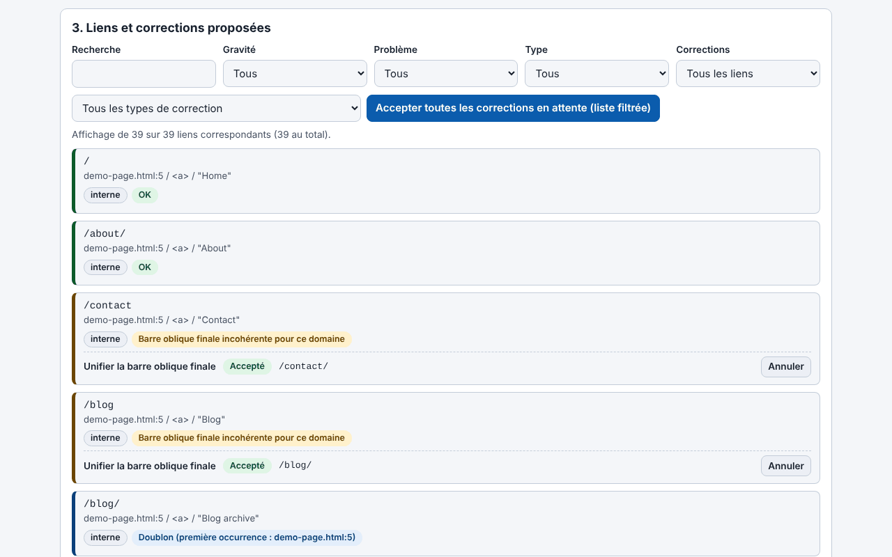

# Trade-Free Link Guardian

[English](README.md) · [Română](README.ro.md) · **Français** · [Italiano](README.it.md) · [Español](README.es.md) · [Português](README.pt.md) · [Deutsch](README.de.md) · [Magyar](README.hu.md)

**Version :** 1.35.0 · **Dernière mise à jour :** 2026-10-19

Langues de l'interface : **Română, English, Français, Italiano, Español, Português (PT), Deutsch, Magyar**

> **Deux variantes :** le plugin WordPress (le fichier `trade-free-link-guardian.php`) et une **application web en un seul fichier** (`index.html`) qui s'exécute dans le navigateur, hors ligne, sans WordPress : **[En ligne](https://chiuta.github.io/Trade-Free-Link-Guardian/)**.

## L'application web (`index.html`)

Vous collez ou téléversez du HTML, du Markdown, du texte, un export WXR ou un sitemap et vous obtenez : les liens extraits et classés, les problèmes détectés hors ligne (http, paramètres de suivi, www/non-www, doublons, adresses malformées), des corrections déterministes avec annulation, le document corrigé, un export CSV (avec protection contre l'injection de formules) et JSON, ainsi qu'un rapport imprimable. Roumain et anglais ; raccourcis clavier. Elle n'effectue aucune requête réseau et n'a ni pistage, ni cookies, ni comptes. Elle ne vérifie pas si les liens externes répondent (le navigateur ne le permet pas de façon fiable) — pour cela, utilisez le plugin.

Plugin WordPress qui trouve les liens morts dans les articles, pages, menus et widgets et répare de façon déterministe tout ce qui peut l'être — il s'exécute sur votre serveur, sans compte SaaS et sans télémétrie.

## Ce que c'est

Un vérificateur de liens local. Les liens internes sont vérifiés structurellement (base de données et système de fichiers), les liens externes par une requête HTTP envoyée directement par votre serveur à la destination du lien. Le plugin est un seul fichier PHP (`trade-free-link-guardian.php`), sans étape de build et sans dépendances embarquées — la philosophie « sans frontières » / trade-free.

## Fonctions (vérifiées dans le code)

- Analyse : articles, pages et types de contenu publics choisis, menus classiques et de blocs, widgets, images en option ; extraction à la fois depuis le HTML et depuis les attributs des blocs.
- Vérification : HEAD avec repli sur GET `Range: bytes=0-0` ; redirections suivies pas à pas (5 au maximum), en distinguant les permanentes (301/308) des temporaires ; vérifications concurrentes (20 par défaut) ; une URL unique n'est vérifiée qu'une seule fois par analyse.
- Corrections automatiques (chacune activable dans les Réglages) : `http`→`https`, bascule `www.`, redirection permanente suivie jusqu'à la destination finale, slug renommé (`_wp_old_slug`), autres motifs déterministes.
- Corrections manuelles : remplacement d'URL, suppression du lien (le texte/l'image est conservé), restauration depuis la corbeille, note, ignorer.
- Journal des corrections avec annulation (exception : la suppression du lien n'est pas annulée automatiquement) ; un « rapport de propositions » qui ne modifie rien.
- Moniteur 404 et règles locales de redirection 301/302/410 (correspondance exacte du chemin).
- Planification WP-Cron (désactivée/quotidienne/hebdomadaire) avec e-mail de notification ; avertissement dans l'éditeur pour les liens déjà connus comme morts.
- Export CSV (avec protection contre l'injection de formules), rapport de conformité imprimable, multisite.
- En option, désactivés par défaut : détection de la « dérive » du contenu, recherche dans la Wayback Machine, liens vers archive.today et Memento.

## Mode d'emploi

1. Copiez le dossier dans `wp-content/plugins/` (ou installez l'archive via **Extensions → Ajouter → Téléverser**) et activez-le.
2. **Link Guardian → Réglages** : choisissez les types de contenu et les corrections automatiques autorisées.
3. **Link Guardian → Tableau de bord → Analyser maintenant**.
4. Dans **Liens**, filtrez par « Cassés » ; sur chaque ligne : Revérifier, Corriger automatiquement, Modifier l'URL, Supprimer le lien, Ignorer.
5. Avant les corrections en masse, utilisez le rapport de propositions ; ensuite vous pouvez annuler depuis **Journal des corrections**.
6. Faites une sauvegarde de la base de données avant les premières corrections en masse.

## Confidentialité et réseau

- Les seules requêtes HTTP sortantes : (1) la vérification des liens de votre propre contenu (y compris la dérive optionnelle, qui télécharge au plus 1 Mio de la page) ; (2) en option, `archive.org/wayback/available?url=...` au clic sur « Trouver une version archivée », uniquement si le réglage est activé. Les liens archive.today / Memento / Buy Me a Coffee sont de simples liens ouverts par votre navigateur au clic.
- Il n'y a ni mises à jour propres, ni outils d'analyse, ni licences, ni appels « phone-home ».
- **User-Agent :** par défaut, le plugin envoie un User-Agent de navigateur Chrome (réglage modifiable), et non un User-Agent qui l'identifie ; les destinations n'apprennent pas le nom de votre site par l'en-tête. Vous pouvez en définir un honnête, de la forme `TradeFreeLinkGuardian/x.y (+site)`, dans les Réglages.
- Le **moniteur 404** s'exécute sur les requêtes des visiteurs qui arrivent sur une 404 et, par défaut, enregistre le chemin demandé, l'en-tête Referer (s'il existe) et un indicateur robot/humain ; il n'enregistre pas l'IP. Il est effacé après 60 jours et peut être désactivé dans les Réglages. Si vous avez des visiteurs dans l'UE, mentionnez-le dans la politique de confidentialité.
- La désinstallation (suppression depuis Extensions) supprime les tables, options et transients créés.

## Limites et avertissements

- Le plugin **modifie du contenu réel** (`post_content`, widgets, menus). Faites des sauvegardes. La suppression d'un lien n'est pas annulée automatiquement ; pour un élément de menu classique, la suppression **efface définitivement** l'élément.
- La correction « redirection permanente » réécrit le lien vers la destination de la redirection d'un site tiers ; si ce site a été repris par quelqu'un d'autre, votre lien suit la nouvelle destination. Désactivez l'option si vous ne voulez pas de ce risque.
- Un 403 signifie souvent un blocage des robots, et non un lien mort.
- Les versions antérieures à 1.33.1 pouvaient supprimer les barres obliques inverses du contenu des articles modifiés par des corrections ; pour les articles concernés, utilisez les Révisions WordPress.
- Testé uniquement par analyse de code et `php -l` ; il n'a pas été exécuté sur une installation WordPress dans le cadre de cet audit.
- L'interface compte 8 langues (RO, EN, FR, IT, ES, PT, DE, HU), choisies dans un sélecteur (par défaut, la langue du navigateur, sinon l'anglais ; le choix n'est pas mémorisé, conformément au principe trade-free).

## Exécution locale

Il n'y a pas de build. Pour le développement : `wp-content/plugins/trade-free-link-guardian/` + une instance WordPress locale. Voir `CONTRIBUTING.md`. Le dossier `.wordpress-org/` contient les icônes et bannières pour le répertoire WordPress.org.

## Historique / Changelog

### 1.34.0 — 2026-10-14
- Sauvegarde et étiquetage des données (fff-kit).

### web 1.33.5 — 12 octobre 2026
- La version et la date de la dernière mise à jour sont affichées dans l'application (pied de page) ; le plugin reste en 1.33.1, inchangé.

### web 1.33.4 — 11 octobre 2026
- Application web : les schémas erronés comme `htp:/bad` (avec une seule barre) sont désormais signalés comme URL malformée ; nouvelles vérifications : `http:example.com` (sans barres, avec réparation en `http://example.com`) et port hors de l'intervalle 0–65535.
- Hachage CSP du script recalculé ; le plugin reste en 1.33.1, inchangé.

### web 1.33.3 — 11 octobre 2026
- Application web : raccourcis clavier (Ctrl+Entrée dans la zone de texte analyse le texte collé ; « / » place le focus sur le filtre des résultats), avec une indication dans l'interface (roumain et anglais) ; respecte `prefers-reduced-motion`.
- Corrigé : la version affichée dans l'en-tête, celle des exports (`version` dans le JSON) et celle du README coïncident désormais (1.33.3-web) ; le plugin reste en 1.33.1, inchangé.

### web 1.33.2 — 11 octobre 2026
- Application web : nouvelle correction « Réparer le schéma malformé » (http// → http://, http:/, http;//, htps://, http:///, schéma doublé) ; le lien « http//bad » est désormais réparé au niveau du schéma, tout en restant signalé comme dépourvu de TLD.
- Hachage CSP du script recalculé ; version de l'application web 1.33.2 (le plugin reste en 1.33.1, inchangé).

## Licence

MIT (voir `LICENSE`).

## Auteur

Alexio — Alexandru-Ionuț Chiuță · contact : alexio@trom.tf · https://trom.tf/

## Résumé en anglais

Un vérificateur de liens cassés WordPress auto-hébergé et correcteur déterministe de liens (un seul fichier PHP, WordPress 6.5+, PHP 7.4+). Chaque requête sortante vise un lien de votre propre contenu ; le seul appel tiers optionnel est une recherche dans la Wayback Machine que vous déclenchez à la main. Pas de télémétrie, pas de SaaS. La version 1.33.1 corrige une faille SSRF dans le vérificateur concurrent et un bogue de suppression de barres obliques inverses lors de la réécriture du contenu. Il modifie le contenu réel des articles : conservez des sauvegardes.
