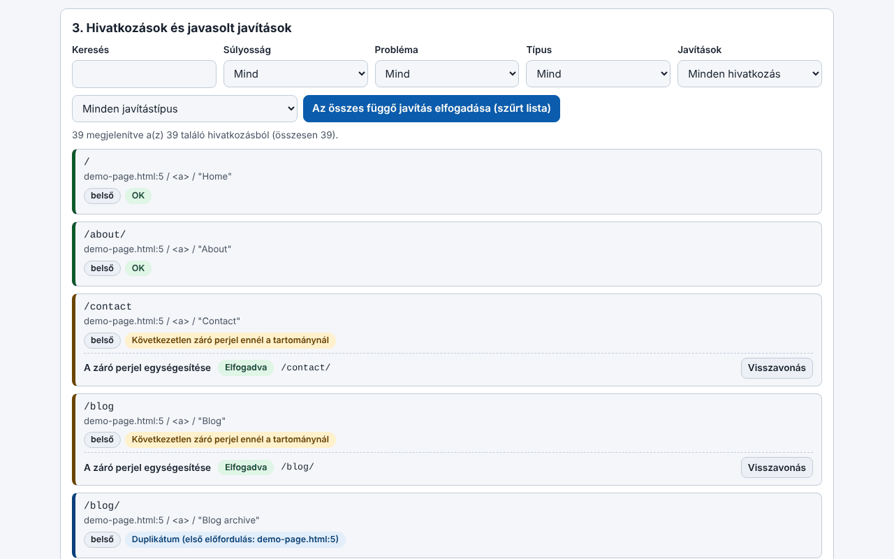

# Trade-Free Link Guardian

[English](README.md) · [Română](README.ro.md) · [Français](README.fr.md) · [Italiano](README.it.md) · [Español](README.es.md) · [Português](README.pt.md) · [Deutsch](README.de.md) · **Magyar**

**Verzió:** 1.36.4 · **Utolsó frissítés:** 2026-10-23

A felület nyelvei: **Română, English, Français, Italiano, Español, Português (PT), Deutsch, Magyar**

> **Két változat:** a WordPress-bővítmény (a `trade-free-link-guardian.php` fájl) és egy **egyfájlos webalkalmazás** (`index.html`), amely a böngészőben fut, offline, WordPress nélkül: **[Élő](https://chiuta.github.io/Trade-Free-Link-Guardian/)**.

## A webalkalmazás (`index.html`)

HTML-t, Markdownt, szöveget, WXR-exportot vagy sitemapet illesztesz be vagy töltesz fel, és megkapod: a kinyert és osztályozott hivatkozásokat, az offline észlelt problémákat (http, követőparaméterek, www/nem-www, duplikátumok, hibás formátumú címek), determinisztikus javításokat visszavonással, a javított dokumentumot, CSV-exportot (képletbeszúrás elleni védelemmel) és JSON-t, valamint nyomtatható jelentést. Román és angol nyelven; billentyűparancsokkal. Nem küld hálózati kéréseket, nincs benne követés, süti vagy fiók. Nem ellenőrzi, hogy a külső hivatkozások válaszolnak-e (a böngésző ezt megbízhatóan nem teszi lehetővé) — ehhez használd a bővítményt.

WordPress-bővítmény, amely megtalálja a bejegyzésekben, oldalakon, menükben és widgetekben lévő halott hivatkozásokat, és determinisztikusan megjavít mindent, ami javítható — a saját szervereden fut, SaaS-fiók és telemetria nélkül.

## Mi ez

Helyi hivatkozás-ellenőrző. A belső hivatkozásokat szerkezetileg ellenőrzi (adatbázis és fájlrendszer), a külsőket egy HTTP-kéréssel, amelyet a szervered közvetlenül a hivatkozás céljához küld. A bővítmény egyetlen PHP-fájl (`trade-free-link-guardian.php`), build-lépés és csomagolt függőségek nélkül — a „határok nélkül” / trade-free filozófia.

## Funkciók (a kódban ellenőrizve)

- Vizsgálat: bejegyzések, oldalak és a kiválasztott nyilvános tartalomtípusok, klasszikus és blokkos menük, widgetek, opcionálisan képek; kinyerés mind a HTML-ből, mind a blokkattribútumokból.
- Ellenőrzés: HEAD, tartalékként GET `Range: bytes=0-0`; az átirányításokat lépésről lépésre követi (legfeljebb 5), megkülönböztetve az állandót (301/308) az ideiglenestől; párhuzamos ellenőrzések (alapértelmezés szerint 20); az egyedi URL-t vizsgálatonként csak egyszer ellenőrzi.
- Automatikus javítások (mindegyik kapcsolható a Beállításokban): `http`→`https`, `www.` váltása, az állandó átirányítás követése a végső célig, átnevezett slug (`_wp_old_slug`), egyéb determinisztikus minták.
- Kézi javítások: URL cseréje, a hivatkozás eltávolítása (a szöveg/kép megmarad), visszaállítás a lomtárból, megjegyzés, mellőzés.
- Javítási napló visszavonással (kivétel: a hivatkozás eltávolítását nem vonja vissza automatikusan); egy „javaslatjelentés”, amely semmit sem módosít.
- 404-monitor és helyi 301/302/410 átirányítási szabályok (pontos útvonalegyezés).
- WP-Cron ütemezés (kikapcsolva/naponta/hetente) értesítő e-maillel; figyelmeztetés a szerkesztőben a már halottként ismert hivatkozásokra.
- CSV-export (képletbeszúrás elleni védelemmel), nyomtatható megfelelőségi jelentés, multisite.
- Opcionális, alapértelmezés szerint kikapcsolt: a tartalom „elsodródásának” észlelése, keresés a Wayback Machine-ben, hivatkozások az archive.today és a Memento felé.

## Használati útmutató

1. Másold a mappát a `wp-content/plugins/` könyvtárba (vagy telepítsd az archívumot a **Bővítmények → Új hozzáadása → Feltöltés** menüpontból), és aktiváld.
2. **Link Guardian → Beállítások**: válaszd ki a tartalomtípusokat és azt, hogy mely automatikus javítások engedélyezettek.
3. **Link Guardian → Vezérlőpult → Vizsgálat most**.
4. A **Hivatkozások** alatt szűrj a „Hibás” értékre; minden sorban: Újraellenőrzés, Automatikus javítás, URL szerkesztése, Hivatkozás eltávolítása, Mellőzés.
5. A tömeges javítások előtt használd a javaslatjelentést; utána a **Javítási naplóból** visszavonhatsz.
6. Az első tömeges javítások előtt készíts biztonsági mentést az adatbázisról.

## Adatvédelem és hálózat

- Az egyetlen kimenő HTTP-kérések: (1) a saját tartalmaidban lévő hivatkozások ellenőrzése (beleértve az opcionális elsodródás-észlelést, amely legfeljebb 1 MiB-ot tölt le az oldalból); (2) opcionálisan az `archive.org/wayback/available?url=...` a „Archivált változat keresése” gombra kattintva, csak ha a beállítás be van kapcsolva. Az archive.today / Memento / Buy Me a Coffee hivatkozások egyszerű hivatkozások, amelyeket a böngésződ nyit meg kattintásra.
- Nincsenek saját frissítések, analitika, licencek vagy „phone-home” hívások.
- **User-Agent:** alapértelmezés szerint a bővítmény Chrome böngésző User-Agentet küld (szerkeszthető beállítás), nem olyat, amely azonosítja; a célok nem tudják meg a webhelyed nevét a fejlécből. A Beállításokban megadhatsz egy őszintét, `TradeFreeLinkGuardian/x.y (+webhely)` alakban.
- A **404-monitor** a 404-re jutó látogatók kérésein fut, és alapértelmezés szerint eltárolja a kért útvonalat, a Referer fejlécet (ha van) és egy bot/ember jelzőt; az IP-címet nem tárolja. 60 nap után törlődik, és a Beállításokban kikapcsolható. Ha vannak látogatóid az EU-ban, említsd meg az adatvédelmi szabályzatban.
- Az eltávolítás (törlés a Bővítményekből) törli a létrehozott táblákat, beállításokat és tranzienseket.

## Korlátok és figyelmeztetések

- A bővítmény **valódi tartalmat módosít** (`post_content`, widgetek, menük). Készíts biztonsági mentést. A hivatkozás eltávolítását nem vonja vissza automatikusan; klasszikus menüelem esetén az eltávolítás **véglegesen törli** az elemet.
- Az „állandó átirányítás” javítás a hivatkozást oda írja át, ahová egy harmadik fél webhelyének átirányítása vezet; ha azt a webhelyet valaki más vette át, a hivatkozásod az új célt követi. Kapcsold ki az opciót, ha nem akarod ezt a kockázatot.
- A 403 gyakran botok blokkolását jelenti, nem halott hivatkozást.
- Az 1.33.1 előtti verziók törölhették a visszaperjeleket a javításokkal módosított bejegyzések tartalmából; az érintett bejegyzéseknél használd a WordPress-revíziókat.
- Csak kódelemzéssel és `php -l` paranccsal tesztelve; ennek az auditnak a keretében nem futtatták WordPress-telepítésen.
- A felület 8 nyelvű (RO, EN, FR, IT, ES, PT, DE, HU), egy választóból állítható (alapértelmezés szerint a böngésző nyelvét követi, egyébként angol; a választás nem tárolódik, a trade-free elvnek megfelelően).

## Helyi futtatás

Nincs build. Fejlesztéshez: `wp-content/plugins/trade-free-link-guardian/` + egy helyi WordPress-példány. Lásd a [`CONTRIBUTING.hu.md`](CONTRIBUTING.hu.md) fájlt. A `.wordpress-org/` mappa a WordPress.org könyvtár ikonjait és bannereit tartalmazza.

## Előzmények / Changelog

### 1.36.4 — 2026-10-23
- Helyi gazdák felismerése: a `localhostile.com` vagy `10.pelda.hu` már nem számít helyinek (és nem kerüli el a „http, nem https” figyelmeztetést); a `localhost`, az IP-címek és a `*.local/.internal/.lan` továbbra is helyi.

### 1.36.2 — 2026-10-22
- fff-kit 1.1.4: érintési célpontok és minimális szövegméret

### 1.36.1 — 2026-10-22
- fff-kit 1.1.2: PBKDF2 600 000 iterációval, clickjacking elleni védelem.

### 1.36.0 — 2026-10-22
- A webes eszköz mostantól valóban offline is működik: valódi service worker (cache-first, háttérben történő újraellenőrzéssel), PWA-jegyzék és ikonok; https-en kiszolgálva telepíthető. A fájl továbbra is önállóan működik file://-ról.
- Javított átláthatósági címke: a demó példa már nem jelenik meg hamis külső gazdagépként (üres egress); a serviceWorker deklarált, a felület 8 nyelve fel van sorolva.

### 1.34.0 — 2026-10-14
- Biztonsági mentés és adatcímkézés (fff-kit).

### web 1.33.5 — 2026. október 12.
- A verzió és az utolsó frissítés dátuma megjelenik az alkalmazásban (lábléc); a bővítmény 1.33.1 marad, érintetlenül.

### web 1.33.4 — 2026. október 11.
- Webalkalmazás: a hibás sémák, például a `htp:/bad` (egyetlen perjellel), mostantól hibás formátumú URL-ként vannak megjelölve; új ellenőrzések: `http:example.com` (perjelek nélkül, `http://example.com`-ra javítással) és a 0–65535 tartományon kívüli port.
- A szkript CSP-hash-e újraszámolva; a bővítmény 1.33.1 marad, érintetlenül.

### web 1.33.3 — 2026. október 11.
- Webalkalmazás: billentyűparancsok (a szövegmezőben a Ctrl+Enter elemzi a beillesztett szöveget; a „/” a fókuszt a találati szűrőre teszi), a felületen súgóval (román és angol); tiszteletben tartja a `prefers-reduced-motion` beállítást.
- Javítva: a fejlécben megjelenő verzió, az exportokban szereplő (`version` a JSON-ban) és a README-ben lévő mostantól egyezik (1.33.3-web); a bővítmény 1.33.1 marad, érintetlenül.

### web 1.33.2 — 2026. október 11.
- Webalkalmazás: új javítás: „Hibás séma javítása” (http// → http://, http:/, http;//, htps://, http:///, dupla séma); a „http//bad” hivatkozás mostantól a sémánál javításra kerül, bár továbbra is TLD nélkülinek van jelölve.
- A szkript CSP-hash-e újraszámolva; a webalkalmazás verziója 1.33.2 (a bővítmény 1.33.1 marad, érintetlenül).

## Licenc

MIT (lásd `LICENSE`).

## Szerző

Alexio — Alexandru-Ionuț Chiuță · kapcsolat: alexio@trom.tf · https://trom.tf/

## Összefoglaló
Önállóan üzemeltetett WordPress hibás hivatkozás-ellenőrző és determinisztikus hivatkozásjavító (egyetlen PHP-fájl, WordPress 6.5+, PHP 7.4+). Minden kimenő kérés a saját tartalmadban lévő hivatkozásra irányul; az egyetlen opcionális külső hívás egy Wayback Machine-lekérdezés, amelyet kézzel indítasz. Nincs telemetria, nincs SaaS. Az 1.33.1-es verzió javít egy SSRF-rést a párhuzamos ellenőrzőben és egy visszaper-törlési hibát a tartalom átírásakor. Valódi bejegyzéstartalmat szerkeszt: tarts biztonsági mentést.
