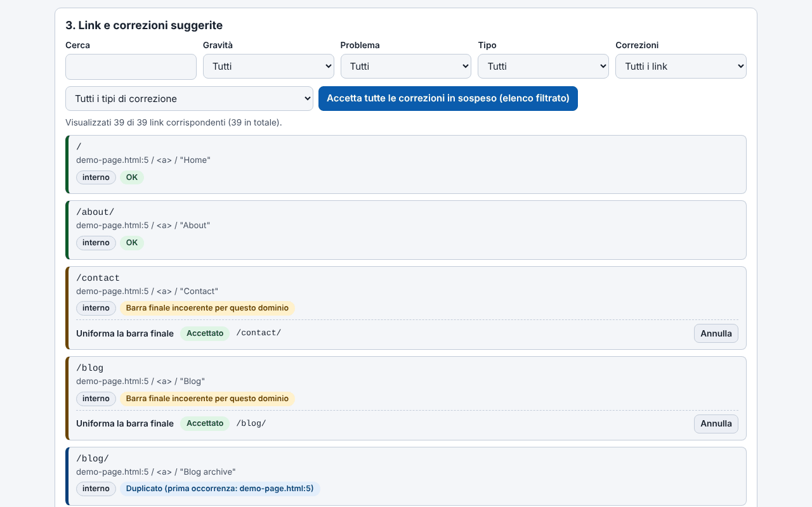

# Trade-Free Link Guardian

[English](README.md) · [Română](README.ro.md) · [Français](README.fr.md) · **Italiano** · [Español](README.es.md) · [Português](README.pt.md) · [Deutsch](README.de.md) · [Magyar](README.hu.md)

**Versione:** 2.0.1 · **Ultimo aggiornamento:** 2026-10-27

Lingue dell'interfaccia: **Română, English, Français, Italiano, Español, Português (PT), Deutsch, Magyar**

> **Due varianti:** il plugin WordPress (il file `trade-free-link-guardian.php`) e un'**app web in un unico file** (`index.html`) che gira nel browser, offline, senza WordPress: **[Online](https://chiuta.github.io/Trade-Free-Link-Guardian/)**.

## L'app web (`index.html`)

Incolli o carichi HTML, Markdown, testo, un'esportazione WXR o una sitemap e ottieni: i link estratti e classificati, i problemi rilevati offline (http, parametri di tracciamento, www/non-www, duplicati, indirizzi malformati), correzioni deterministiche con annullamento, il documento corretto, l'esportazione CSV (con protezione contro l'iniezione di formule) e JSON, oltre a un report stampabile. Rumeno e inglese; scorciatoie da tastiera. Non effettua alcuna richiesta di rete e non ha tracciamento, cookie o account. Non verifica se i link esterni rispondono (il browser non lo consente in modo affidabile) — per questo usa il plugin.

Plugin WordPress che trova i link morti in articoli, pagine, menu e widget e ripara in modo deterministico ciò che si può riparare — gira sul tuo server, senza account SaaS e senza telemetria.

## Che cos'è

Un verificatore di link locale. I link interni vengono verificati strutturalmente (database e file system), quelli esterni tramite una richiesta HTTP inviata direttamente dal tuo server alla destinazione del link. Il plugin è un unico file PHP (`trade-free-link-guardian.php`), senza fase di build e senza dipendenze incluse — la filosofia «senza frontiere» / trade-free.

## Funzioni (verificate nel codice)

- Scansione: articoli, pagine e tipi di contenuto pubblici scelti, menu classici e a blocchi, widget, opzionalmente immagini; estrazione sia dall'HTML sia dagli attributi dei blocchi.
- Verifica: HEAD con ripiego su GET `Range: bytes=0-0`; reindirizzamenti seguiti passo per passo (max. 5), distinguendo i permanenti (301/308) dai temporanei; verifiche concorrenti (20 per impostazione predefinita); un URL univoco viene verificato una sola volta per scansione.
- Correzioni automatiche (ciascuna attivabile nelle Impostazioni): `http`→`https`, commutazione `www.`, reindirizzamento permanente seguito fino alla destinazione finale, slug rinominato (`_wp_old_slug`), altri schemi deterministici.
- Correzioni manuali: sostituzione dell'URL, rimozione del link (il testo/l'immagine viene mantenuto), ripristino dal cestino, nota, ignora.
- Registro delle correzioni con annullamento (eccezione: la rimozione del link non si annulla automaticamente); un «report di proposte» che non modifica nulla.
- Monitor 404 e regole locali di reindirizzamento 301/302/410 (corrispondenza esatta del percorso).
- Pianificazione WP-Cron (disattivata/giornaliera/settimanale) con e-mail di notifica; avviso nell'editor per i link già noti come morti.
- Esportazione CSV (con protezione contro l'iniezione di formule), report di conformità stampabile, multisite.
- Opzionali, disattivati per impostazione predefinita: rilevamento del «drift» del contenuto, ricerca nella Wayback Machine, link ad archive.today e Memento.

## Guida all'uso

1. Copia la cartella in `wp-content/plugins/` (oppure installa l'archivio da **Plugin → Aggiungi nuovo → Carica**) e attivala.
2. **Link Guardian → Impostazioni**: scegli i tipi di contenuto e quali correzioni automatiche sono consentite.
3. **Link Guardian → Bacheca → Scansiona ora**.
4. In **Link**, filtra per «Interrotti»; su ogni riga: Riverifica, Correggi automaticamente, Modifica URL, Rimuovi link, Ignora.
5. Prima delle correzioni in blocco, usa il report di proposte; poi puoi annullare da **Registro correzioni**.
6. Fai una copia di sicurezza del database prima delle prime correzioni in blocco.

## Privacy e rete

- Le sole richieste HTTP in uscita: (1) la verifica dei link del tuo contenuto (compreso il drift opzionale, che scarica al massimo 1 MiB della pagina); (2) opzionalmente, `archive.org/wayback/available?url=...` al clic su «Trova versione archiviata», solo se l'impostazione è attiva. I link archive.today / Memento / Buy Me a Coffee sono semplici link aperti dal tuo browser al clic.
- Non esistono aggiornamenti propri, analitica, licenze o chiamate «phone-home».
- **User-Agent:** per impostazione predefinita il plugin invia uno User-Agent di browser Chrome (impostazione modificabile), non uno che lo identifichi; le destinazioni non apprendono il nome del tuo sito dall'intestazione. Puoi impostarne uno onesto, della forma `TradeFreeLinkGuardian/x.y (+sito)`, nelle Impostazioni.
- Il **monitor 404** agisce sulle richieste dei visitatori che arrivano a una 404 e, per impostazione predefinita, memorizza il percorso richiesto, l'intestazione Referer (se presente) e un indicatore bot/umano; non memorizza l'IP. Viene cancellato dopo 60 giorni e si può disattivare dalle Impostazioni. Se hai visitatori nell'UE, menzionalo nell'informativa sulla privacy.
- La disinstallazione (eliminazione da Plugin) rimuove le tabelle, le opzioni e i transient creati.

## Limiti e avvertenze

- Il plugin **modifica contenuti reali** (`post_content`, widget, menu). Fai copie di sicurezza. La rimozione del link non si annulla automaticamente; per una voce di menu classica, la rimozione **elimina definitivamente** la voce.
- La correzione «reindirizzamento permanente» riscrive il link verso la destinazione del reindirizzamento di un sito terzo; se quel sito è stato rilevato da qualcun altro, il tuo link segue la nuova destinazione. Disattiva l'opzione se non vuoi questo rischio.
- Un 403 significa spesso blocco dei bot, non un link morto.
- Le versioni precedenti alla 1.33.1 potevano eliminare i backslash dal contenuto degli articoli modificati tramite correzioni; per gli articoli interessati usa le Revisioni di WordPress.
- Testato solo tramite analisi del codice e `php -l`; non è stato eseguito su un'installazione WordPress nell'ambito di questo audit.
- L'interfaccia ha 8 lingue (RO, EN, FR, IT, ES, PT, DE, HU), scelte da un selettore (per impostazione predefinita segue la lingua del browser, altrimenti l'inglese; la scelta non viene memorizzata, in linea con il principio trade-free).

## Esecuzione locale

Non c'è build. Per lo sviluppo: `wp-content/plugins/trade-free-link-guardian/` + un'istanza WordPress locale. Vedi [`CONTRIBUTING.it.md`](CONTRIBUTING.it.md). La cartella `.wordpress-org/` contiene le icone e i banner per la directory di WordPress.org.

## Cronologia / Changelog

### 1.36.4 — 2026-10-23
- Rilevamento degli host locali: `localhostile.com` o `10.esempio.it` non sono più trattati come locali (e non sfuggono più all'avviso «http, non https»); `localhost`, gli indirizzi IP e `*.local/.internal/.lan` restano locali.

### 1.36.2 — 2026-10-22
- fff-kit 1.1.4: bersagli touch e testo minimo

### 1.36.1 — 2026-10-22
- fff-kit 1.1.2: PBKDF2 a 600.000 iterazioni, protezione anti-clickjacking.

### 1.36.0 — 2026-10-22
- Lo strumento web funziona ora davvero offline: vero service worker (cache-first con riconvalida in background), manifest PWA e icone; installabile quando servito via https. Il file continua a funzionare da solo da file://.
- Etichetta di trasparenza corretta: l'esempio demo non compare più come falso host esterno (egress vuoto); serviceWorker è dichiarato e sono elencate le 8 lingue dell'interfaccia.

### 1.34.0 — 2026-10-14
- Copia di riserva ed etichettatura dei dati (fff-kit).

### web 1.33.5 — 12 ottobre 2026
- La versione e la data dell'ultimo aggiornamento sono mostrate nell'app (piè di pagina); il plugin resta alla 1.33.1, invariato.

### web 1.33.4 — 11 ottobre 2026
- App web: gli schemi errati come `htp:/bad` (con una sola barra) sono ora segnalati come URL malformato; nuove verifiche: `http:example.com` (senza barre, con riparazione in `http://example.com`) e porta fuori dall'intervallo 0–65535.
- Hash CSP dello script ricalcolato; il plugin resta alla 1.33.1, invariato.

### web 1.33.3 — 11 ottobre 2026
- App web: scorciatoie da tastiera (Ctrl+Invio nella casella di testo analizza il testo incollato; «/» sposta il focus sul filtro dei risultati), con un suggerimento nell'interfaccia (rumeno e inglese); rispetta `prefers-reduced-motion`.
- Corretto: la versione mostrata nell'intestazione, quella delle esportazioni (`version` nel JSON) e quella del README ora coincidono (1.33.3-web); il plugin resta alla 1.33.1, invariato.

### web 1.33.2 — 11 ottobre 2026
- App web: nuova correzione «Ripara lo schema malformato» (http// → http://, http:/, http;//, htps://, http:///, schema doppio); il link «http//bad» ora viene riparato nello schema, pur restando segnalato come privo di TLD.
- Hash CSP dello script ricalcolato; versione dell'app web 1.33.2 (il plugin resta alla 1.33.1, invariato).

## Licenza

MIT (vedi `LICENSE`).

## Autore

Alexio — Alexandru-Ionuț Chiuță · contatto: alexio@trom.tf · https://trom.tf/

## Riepilogo
Un verificatore di link interrotti per WordPress auto-ospitato e correttore deterministico di link (un unico file PHP, WordPress 6.5+, PHP 7.4+). Ogni richiesta in uscita va a un link presente nel tuo contenuto; l'unica chiamata a terzi facoltativa è una ricerca nella Wayback Machine che avvii a mano. Nessuna telemetria, nessun SaaS. La versione 1.33.1 corregge una falla SSRF nel verificatore concorrente e un bug di rimozione dei backslash nella riscrittura del contenuto. Modifica il contenuto reale degli articoli: conserva le copie di sicurezza.
