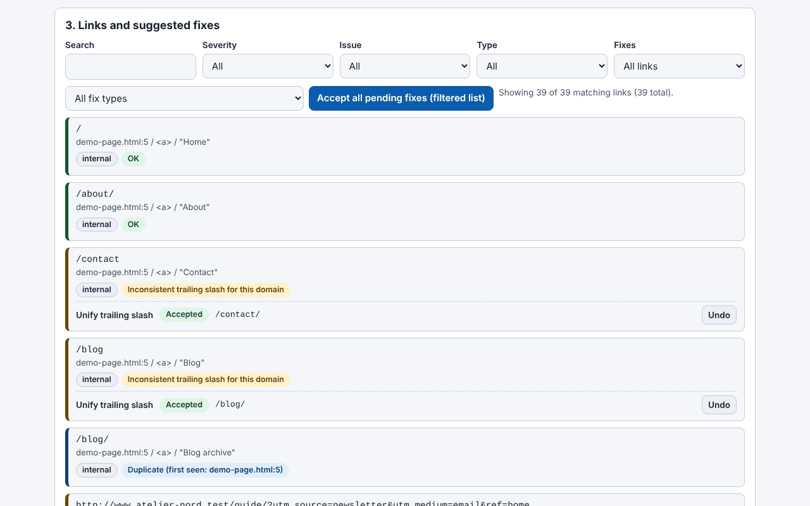

# Trade-Free Link Guardian

**English** · [Română](README.ro.md) · [Français](README.fr.md) · [Italiano](README.it.md) · [Español](README.es.md) · [Português](README.pt.md) · [Deutsch](README.de.md) · [Magyar](README.hu.md)

**Version:** 2.1.0 · **Last updated:** 2026-10-27

**Status:** web app — stable; WordPress plugin (1.34.0) — experimental (not yet run on a real WordPress by an independent tester). **Offline:** the web app is fully offline; the plugin runs on your server and needs internet only to check external links (and, if you enable it, the Wayback lookup).

Interface languages: **Română, English, Français, Italiano, Español, Português (PT), Deutsch, Magyar**

> **Two variants:** the WordPress plugin (the `trade-free-link-guardian.php` file) and a **single-file web app** (`index.html`) that runs in the browser, offline, without WordPress: **[Live](https://chiuta.github.io/Trade-Free-Link-Guardian/)**.

## The web app (`index.html`)

You paste or upload HTML, Markdown, text, a WXR export or a sitemap and you get: the extracted and classified links, problems detected offline (http, tracking parameters, www/non-www, duplicates, malformed addresses), deterministic fixes with undo, the corrected document, CSV export (with formula-injection protection) and JSON, plus a printable report. Romanian and English; keyboard shortcuts. It makes no network requests and has no tracking, cookies or accounts. It does not check whether external links respond (the browser does not reliably allow this) — for that, use the plugin.

A WordPress plugin that finds dead links in posts, pages, menus and widgets and repairs deterministically whatever can be repaired — it runs on your server, with no SaaS account and no telemetry.

## What it is

A local link checker. Internal links are checked structurally (database and file system), external ones through an HTTP request sent directly by your server to the link's destination. The plugin is a single PHP file (`trade-free-link-guardian.php`), with no build step and no bundled dependencies — the "without borders" / trade-free philosophy.

## Features (checked in code)

- Scanning: posts, pages and chosen public content types, classic and block menus, widgets, optionally images; extraction both from HTML and from block attributes.
- Checking: HEAD with fallback to GET `Range: bytes=0-0`; redirects followed step by step (max. 5), distinguishing permanent (301/308) from temporary; concurrent checks (default 20); a unique URL is checked only once per scan.
- Automatic fixes (each can be toggled in Settings): `http`→`https`, `www.` switching, permanent redirect followed to the final destination, renamed slug (`_wp_old_slug`), other deterministic patterns.
- Manual fixes: URL replacement, link removal (the text/image is kept), restore from trash, note, ignore.
- Fix log with undo (exception: link removal is not undone automatically); a "proposals report" that changes nothing.
- 404 monitor and local 301/302/410 redirect rules (exact path match).
- WP-Cron scheduling (off/daily/weekly) with a notification e-mail; a warning in the editor for links already known to be dead.
- CSV export (with formula-injection protection), printable compliance report, multisite.
- Optional, disabled by default: content "drift" detection, Wayback Machine lookup, links to archive.today and Memento.
- **Simulation and reversible journal (2.0.0, web app):** “Simulate” shows, document by document, exactly what a batch of fixes would change before you apply it; afterwards “Show differences” lists the change line by line, you can undo all fixes of one document or each entry, and the journal exports as JSON. “Re-analyze” now asks for confirmation (it clears the undo history).
- **Scope:** the changes concern the web app (downloaded files, not a live site); the WordPress plugin was not modified or tested on a real WordPress, so a reversible journal on database posts, the per-category report, redirect chains and soft-404 detection remain plugin work.

## User guide

1. Copy the folder into `wp-content/plugins/` (or install the archive from **Plugins → Add New → Upload**) and activate it.
2. **Link Guardian → Settings**: choose the content types and which automatic fixes are allowed.
3. **Link Guardian → Dashboard → Scan now**.
4. In **Links**, filter by "Broken"; on each row: Re-check, Auto-fix, Edit URL, Remove link, Ignore.
5. Before bulk fixes, use the proposals report; afterwards you can undo from **Fix log**.
6. Back up the database before the first bulk fixes.

## Compatibility, scheduling and e-mail report (plugin)

- **Declared compatibility:** WordPress 6.5+ and PHP 7.4+ (`Requires at least`, `Requires PHP` headers). The `Tested up to: 7.1` header is a declaration by the maintainer, **to be verified**: the plugin was checked by code analysis and `php -l` (PHP 8.3.6), not run on every WordPress/PHP combination. A quick search for common PHP 8-only constructs (`match`, `?->`, enums, `readonly`, attributes) found none, which supports but does not prove PHP 7.4 compatibility. According to make.wordpress.org the WordPress 7.0 schedule lists 20 May 2026 as release date; whether 7.1 is released was not verified.
- **Scheduling (WP-Cron):** Settings → “Schedule & notifications”: Off / Daily / Weekly (default Weekly). One event `tflg_cron_tick` (first run ≈ 1 hour after saving), small chunks with a one-minute follow-up event until the pass is done, a lock against overlapping ticks, plus a daily `tflg_daily_snapshot` for the health history. WP-Cron only runs when the site gets visits: on quiet sites or with `DISABLE_WP_CRON`, trigger `wp-cron.php` / `wp cron event run --due-now` from the server's scheduler.
- **E-mail report:** on by default; after a **scheduled** scan, if broken links increased, one plain-text e-mail (`wp_mail()`) with the new/total counts and a link to the list is sent to the configured address or to the admin e-mail. Not sent for manual scans; since plugin 1.34.0 it also lists up to 10 of the broken URLs (then "... and N more"); the message text is tested with a stand-alone PHP script, but `wp_mail()`, WP-Cron and the database query have **not** been run on a real WordPress.
- **WordPress.org directory:** `readme.txt` is in wordpress.org format (headers, FAQ with the three topics above and the external services, changelog) and `.wordpress-org/` holds icons and banners. **Not submitted or published**; before submitting: check that `Contributors: alexio` is a real wordpress.org username, verify `Tested up to` and run the Plugin Check tool on a real installation.

## Privacy and network

- The only outgoing HTTP requests: (1) checking the links in your own content (including the optional drift, which downloads at most 1 MiB of the page); (2) optionally, `archive.org/wayback/available?url=...` when you click "Find archived version", only if the setting is on. The archive.today / Memento / Buy Me a Coffee links are simple links opened by your browser on click.
- There are no self-updates, analytics, licences or "phone-home" calls.
- **User-Agent:** by default the plugin sends a Chrome browser User-Agent (editable setting), not one that identifies it; destinations do not learn your site's name from the header. You can set an honest one, of the form `TradeFreeLinkGuardian/x.y (+site)`, in Settings.
- The **404 monitor** runs on the requests of visitors who reach a 404 and, by default, stores the requested path, the Referer header (if present) and a bot/human indicator; it does not store IP addresses. It is deleted after 60 days and can be turned off in Settings. If you have visitors in the EU, mention it in your privacy policy.
- Uninstalling (deleting from Plugins) removes the tables, options and transients it created.

## Limits and warnings

- The plugin **modifies real content** (`post_content`, widgets, menus). Make backups. Link removal is not undone automatically; for a classic menu item, removal **deletes the item permanently**.
- The "permanent redirect" fix rewrites the link to wherever a third-party site's redirect leads; if that site has been taken over by someone else, your link follows the new destination. Disable the option if you do not want this risk.
- A 403 often means bot blocking, not a dead link.
- Versions before 1.33.1 could delete backslashes from the content of posts modified through fixes; for affected posts use WordPress Revisions.
- Tested only through code analysis and `php -l`; it was not run on a WordPress installation as part of this audit.
- The interface has 8 languages (RO, EN, FR, IT, ES, PT, DE, HU), chosen from a selector (the default follows the browser language, otherwise English; the choice is not stored, in line with the trade-free principle).

## Running locally

There is no build. For development: `wp-content/plugins/trade-free-link-guardian/` + a local WordPress instance. See [`CONTRIBUTING.en.md`](CONTRIBUTING.en.md). The `.wordpress-org/` folder contains the icons and banners for the WordPress.org directory.

## History / Changelog

### 2.0.1 — 2026-10-27
- Documentation only (the plugin stays at 1.33.1, untouched): declared compatibility, WP-Cron scheduling, e-mail report and external services in `README` and `readme.txt`; “Status” and “Offline” lines; `CHANGELOG.md`. Previously: v2.0.0.

### 1.36.4 — 2026-10-23
- Local-host detection: `localhostile.com` or `10.example.com` are no longer treated as local (and no longer escape the “http, not https” warning); `localhost`, IP addresses and `*.local/.internal/.lan` stay local.

### 1.36.2 — 2026-10-22
- fff-kit 1.1.4: touch targets and minimum text size

### 1.36.1 — 2026-10-22
- fff-kit 1.1.2: PBKDF2 600,000 iterations, anti-clickjacking protection.

### 1.36.0 — 2026-10-22
- The web tool now works offline for real: real service worker (cache-first with background revalidation), PWA manifest and icons; it can be installed when served over https. The file still works on its own from file://.
- Transparency label fixed: the demo sample no longer shows up as a bogus external host (egress is now empty); serviceWorker is declared and the 8 interface languages are listed.

### 1.34.0 — 2026-10-14
- Backup and data labelling (fff-kit).

### web 1.33.5 — 12 October 2026
- The version and the date of the last update are shown in the app (footer); the plugin stays at 1.33.1, untouched.

### web 1.33.4 — 11 October 2026
- Web app: wrong schemes such as `htp:/bad` (with a single slash) are now flagged as a malformed URL; new checks: `http:example.com` (without slashes, with repair to `http://example.com`) and a port outside the 0–65535 range.
- The script's CSP hash was recalculated; the plugin stays at 1.33.1, untouched.

### web 1.33.3 — 11 October 2026
- Web app: keyboard shortcuts (Ctrl+Enter in the text box analyses the pasted text; "/" moves focus to the results filter), with a hint in the interface (Romanian and English); respects `prefers-reduced-motion`.
- Fixed: the version shown in the header, the one in the exports (`version` in JSON) and the one in the README now match (1.33.3-web); the plugin stays at 1.33.1, untouched.

### web 1.33.2 — 11 October 2026
- Web app: new fix "Repair malformed scheme" (http// → http://, http:/, http;//, htps://, http:///, double scheme); the link "http//bad" is now repaired to the scheme, although it remains flagged as lacking a TLD.
- The script's CSP hash was recalculated; web app version 1.33.2 (the plugin stays at 1.33.1, untouched).

## License

MIT (see `LICENSE`).

## Author

Alexio — Alexandru-Ionuț Chiuță · contact: alexio@trom.tf · https://trom.tf/

## English summary

A self-hosted WordPress broken-link checker and deterministic link fixer (single PHP file, WordPress 6.5+, PHP 7.4+). Every outbound request goes to a link in your own content; the only optional third-party call is a Wayback Machine lookup you trigger by hand. No telemetry, no SaaS. Version 1.33.1 fixes an SSRF gap in the concurrent checker and a backslash-stripping bug in content rewriting. It edits real post content: keep backups.
