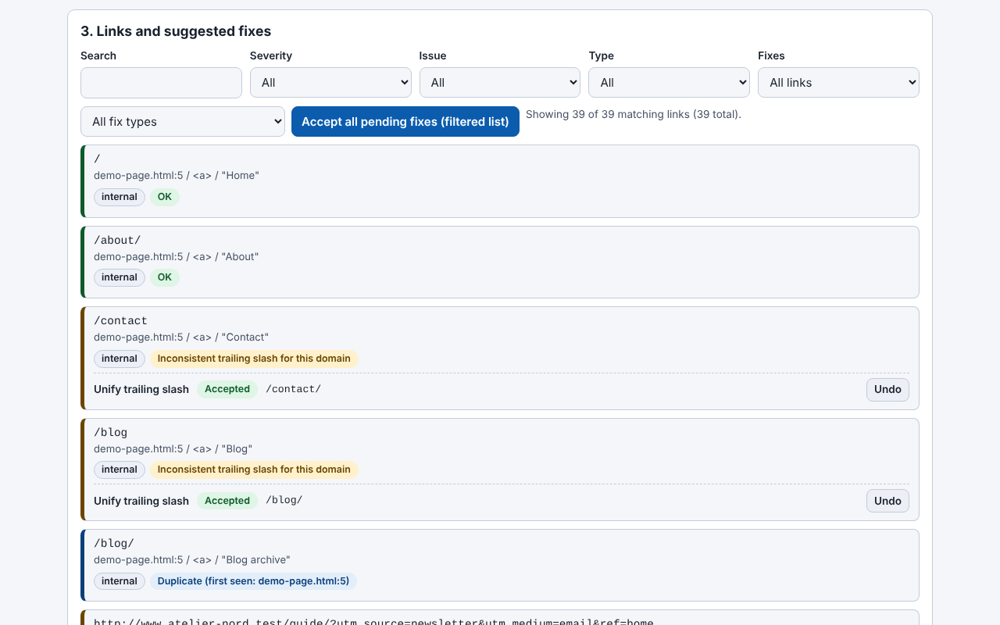

# Trade-Free Link Guardian

[English](README.md) · [Română](README.ro.md) · [Français](README.fr.md) · [Italiano](README.it.md) · [Español](README.es.md) · **Português** · [Deutsch](README.de.md) · [Magyar](README.hu.md)

**Versão:** 1.34.0 · **Última atualização:** 2026-10-14

> **Duas variantes:** o plugin WordPress (o ficheiro `trade-free-link-guardian.php`) e uma **aplicação web de ficheiro único** (`index.html`) que corre no navegador, offline, sem WordPress: **[Online](https://chiuta.github.io/Trade-Free-Link-Guardian/)**.

## A aplicação web (`index.html`)

Cola ou carrega HTML, Markdown, texto, uma exportação WXR ou um sitemap e obtém: as ligações extraídas e classificadas, os problemas detetados offline (http, parâmetros de rastreamento, www/não-www, duplicados, endereços malformados), correções determinísticas com anulação, o documento corrigido, exportação CSV (com proteção contra injeção de fórmulas) e JSON, além de um relatório imprimível. Romeno e inglês; atalhos de teclado. Não faz qualquer pedido de rede e não tem rastreamento, cookies nem contas. Não verifica se as ligações externas respondem (o navegador não o permite de forma fiável) — para isso, use o plugin.

Plugin WordPress que encontra as ligações mortas em artigos, páginas, menus e widgets e repara de forma determinística o que for possível reparar — corre no seu servidor, sem conta SaaS e sem telemetria.

## O que é

Um verificador de ligações local. As ligações internas são verificadas estruturalmente (base de dados e sistema de ficheiros), as externas através de um pedido HTTP enviado diretamente pelo seu servidor ao destino da ligação. O plugin é um único ficheiro PHP (`trade-free-link-guardian.php`), sem passo de compilação e sem dependências incluídas — a filosofia «sem fronteiras» / trade-free.

## Funcionalidades (verificadas no código)

- Análise: artigos, páginas e tipos de conteúdo públicos escolhidos, menus clássicos e de blocos, widgets, opcionalmente imagens; extração tanto do HTML como dos atributos dos blocos.
- Verificação: HEAD com recurso a GET `Range: bytes=0-0`; redirecionamentos seguidos passo a passo (máx. 5), distinguindo os permanentes (301/308) dos temporários; verificações concorrentes (20 por predefinição); um URL único é verificado apenas uma vez por análise.
- Correções automáticas (cada uma pode ser ativada nas Definições): `http`→`https`, alternância de `www.`, redirecionamento permanente seguido até ao destino final, slug renomeado (`_wp_old_slug`), outros padrões determinísticos.
- Correções manuais: substituição do URL, remoção da ligação (o texto/a imagem é mantido), restauro a partir do lixo, nota, ignorar.
- Registo de correções com anulação (exceção: a remoção da ligação não se anula automaticamente); um «relatório de propostas» que não altera nada.
- Monitor de 404 e regras locais de redirecionamento 301/302/410 (correspondência exata do caminho).
- Agendamento com WP-Cron (desligado/diário/semanal) com e-mail de notificação; aviso no editor para ligações já conhecidas como mortas.
- Exportação CSV (com proteção contra injeção de fórmulas), relatório de conformidade imprimível, multissite.
- Opcionais, desativados por predefinição: deteção de «desvio» do conteúdo, pesquisa na Wayback Machine, ligações para archive.today e Memento.

## Manual de utilização

1. Copie a pasta para `wp-content/plugins/` (ou instale o arquivo em **Plugins → Adicionar novo → Carregar**) e ative-o.
2. **Link Guardian → Definições**: escolha os tipos de conteúdo e as correções automáticas permitidas.
3. **Link Guardian → Painel → Analisar agora**.
4. Em **Ligações**, filtre por «Quebradas»; em cada linha: Reverificar, Corrigir automaticamente, Editar URL, Remover ligação, Ignorar.
5. Antes das correções em massa, use o relatório de propostas; depois pode anular em **Registo de correções**.
6. Faça uma cópia de segurança da base de dados antes das primeiras correções em massa.

## Privacidade e rede

- Os únicos pedidos HTTP de saída: (1) a verificação das ligações do seu próprio conteúdo (incluindo o desvio opcional, que descarrega no máximo 1 MiB da página); (2) opcionalmente, `archive.org/wayback/available?url=...` ao clicar em «Encontrar versão arquivada», apenas se a definição estiver ativa. As ligações archive.today / Memento / Buy Me a Coffee são simples ligações abertas pelo seu navegador ao clicar.
- Não existem atualizações próprias, análises, licenças nem chamadas «phone-home».
- **User-Agent:** por predefinição, o plugin envia um User-Agent de navegador Chrome (definição editável), não um que o identifique; os destinos não ficam a saber o nome do seu site pelo cabeçalho. Pode definir um honesto, da forma `TradeFreeLinkGuardian/x.y (+site)`, nas Definições.
- O **monitor de 404** atua sobre os pedidos dos visitantes que chegam a um 404 e, por predefinição, guarda o caminho pedido, o cabeçalho Referer (se existir) e um indicador bot/humano; não guarda o IP. É apagado ao fim de 60 dias e pode ser desligado nas Definições. Se tem visitantes na UE, mencione-o na política de privacidade.
- A desinstalação (eliminar em Plugins) remove as tabelas, opções e transientes criados.

## Limites e avisos

- O plugin **modifica conteúdo real** (`post_content`, widgets, menus). Faça cópias de segurança. A remoção da ligação não se anula automaticamente; para um item de menu clássico, a remoção **elimina definitivamente** o item.
- A correção «redirecionamento permanente» reescreve a ligação para onde leva o redirecionamento de um site de terceiros; se esse site tiver sido adquirido por outra pessoa, a sua ligação segue o novo destino. Desative a opção se não quiser este risco.
- Um 403 significa frequentemente bloqueio de bots, não uma ligação morta.
- As versões anteriores à 1.33.1 podiam eliminar as barras invertidas do conteúdo dos artigos modificados por correções; para os artigos afetados, use as Revisões do WordPress.
- Testado apenas através de análise de código e `php -l`; não foi executado numa instalação WordPress no âmbito desta auditoria.
- Os textos da interface estão em inglês (sem ficheiros de tradução incluídos).

## Execução local

Não há compilação. Para desenvolvimento: `wp-content/plugins/trade-free-link-guardian/` + uma instância local de WordPress. Veja `CONTRIBUTING.md`. A pasta `.wordpress-org/` contém os ícones e faixas para o diretório do WordPress.org.

## Histórico / Changelog

### 1.34.0 — 2026-10-14
- Cópia de segurança e etiquetagem de dados (fff-kit).

### web 1.33.5 — 12 de outubro de 2026
- A versão e a data da última atualização são apresentadas na aplicação (rodapé); o plugin continua na 1.33.1, intacto.

### web 1.33.4 — 11 de outubro de 2026
- Aplicação web: os esquemas errados como `htp:/bad` (com uma só barra) são agora assinalados como URL malformado; novas verificações: `http:example.com` (sem barras, com reparação para `http://example.com`) e porta fora do intervalo 0–65535.
- Hash CSP do script recalculado; o plugin continua na 1.33.1, intacto.

### web 1.33.3 — 11 de outubro de 2026
- Aplicação web: atalhos de teclado (Ctrl+Enter na caixa de texto analisa o texto colado; «/» move o foco para o filtro de resultados), com uma indicação na interface (romeno e inglês); respeita `prefers-reduced-motion`.
- Corrigido: a versão apresentada no cabeçalho, a das exportações (`version` no JSON) e a do README coincidem agora (1.33.3-web); o plugin continua na 1.33.1, intacto.

### web 1.33.2 — 11 de outubro de 2026
- Aplicação web: nova correção «Reparar o esquema malformado» (http// → http://, http:/, http;//, htps://, http:///, esquema duplo); a ligação «http//bad» é agora reparada no esquema, embora continue assinalada como sem TLD.
- Hash CSP do script recalculado; versão da aplicação web 1.33.2 (o plugin continua na 1.33.1, intacto).

## Licença

MIT (veja `LICENSE`).

## Autor

Alexio — Alexandru-Ionuț Chiuță · contacto: alexio@trom.tf · https://trom.tf/

## Resumo em inglês

Um verificador de ligações quebradas para WordPress autoalojado e corretor determinístico de ligações (um único ficheiro PHP, WordPress 6.5+, PHP 7.4+). Todo o pedido de saída vai para uma ligação do seu próprio conteúdo; a única chamada opcional a terceiros é uma consulta à Wayback Machine que aciona manualmente. Sem telemetria, sem SaaS. A versão 1.33.1 corrige uma falha SSRF no verificador concorrente e um erro de remoção de barras invertidas ao reescrever o conteúdo. Edita o conteúdo real dos artigos: mantenha cópias de segurança.
