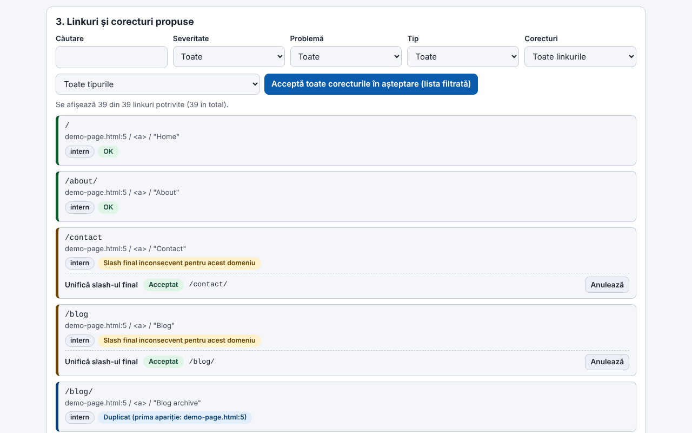
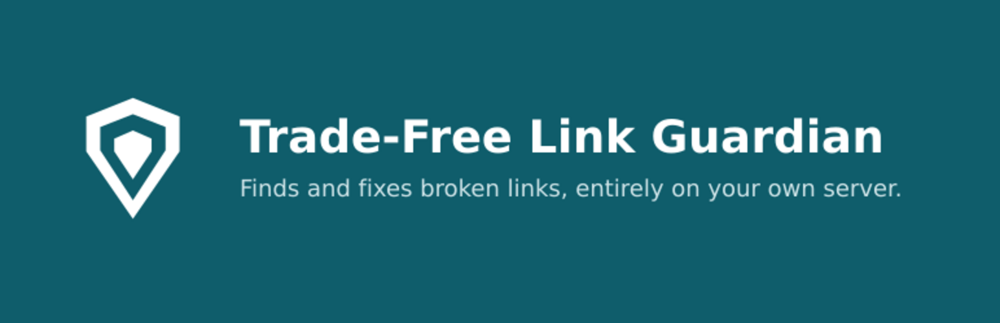

# Trade-Free Link Guardian

[English](README.md) · **Română** · [Français](README.fr.md) · [Italiano](README.it.md) · [Español](README.es.md) · [Português](README.pt.md) · [Deutsch](README.de.md) · [Magyar](README.hu.md)

**Versiune:** 2.1.0 · **Ultima actualizare:** 2026-10-27

**Stare:** aplicația web — stabilă; pluginul WordPress (1.34.0) — experimental (neexecutat încă pe un WordPress real de un tester independent). **Offline:** aplicația web este complet offline; pluginul rulează pe serverul tău și cere internet doar pentru verificarea linkurilor externe (și, dacă o activezi, căutarea Wayback).

Limbile interfeței: **Română, English, Français, Italiano, Español, Português (PT), Deutsch, Magyar**

> **Două variante:** pluginul WordPress (fișierul `trade-free-link-guardian.php`) și o **aplicație web single-file** (`index.html`) care rulează în browser, offline, fără WordPress: **[Live](https://chiuta.github.io/Trade-Free-Link-Guardian/)**.

## Aplicația web (`index.html`)

Lipești sau încarci HTML, Markdown, text, export WXR sau sitemap și primești: linkurile extrase și clasificate, probleme detectate offline (http, parametri de urmărire, www/non-www, dubluri, adrese malformate), corecturi deterministe cu anulare, document corectat, export CSV (cu protecție împotriva formulelor) și JSON, plus raport imprimabil. Română și engleză; scurtături de tastatură. Nu face nicio cerere de rețea, nu are urmărire, cookie-uri sau conturi. Nu verifică dacă linkurile externe răspund (browserul nu permite fiabil acest lucru) — pentru asta folosește pluginul.

Plugin WordPress care găsește linkurile moarte din articole, pagini, meniuri și widgeturi și repară ce se poate repara determinist — rulează pe serverul tău, fără cont SaaS și fără telemetrie.

## Ce este

Un verificator local de linkuri. Linkurile interne se verifică structural (baza de date și sistemul de fișiere), cele externe printr-o cerere HTTP trimisă direct de serverul tău către destinația linkului. Plugin-ul este un singur fișier PHP (`trade-free-link-guardian.php`), fără pas de build și fără dependențe împachetate — filozofia „fără frontiere" / trade-free.

## Funcții (verificate în cod)

- Scanare: articole, pagini și tipuri de conținut publice alese, meniuri clasice și de bloc, widgeturi, opțional imagini; extragere atât din HTML, cât și din atributele blocurilor.
- Verificare: HEAD cu revenire la GET `Range: bytes=0-0`; redirecturi urmate pas cu pas (max. 5), distingând permanent (301/308) de temporar; verificări concurente (implicit 20); un URL unic se verifică o singură dată pe scanare.
- Corecturi automate (fiecare comutabilă în Setări): `http`→`https`, comutare `www.`, redirect permanent urmat până la destinația finală, slug redenumit (`_wp_old_slug`), alte tipare deterministe.
- Corecturi manuale: înlocuire URL, scoaterea linkului (se păstrează textul/imaginea), restaurare din coș, notă, ignorare.
- Jurnal de corecturi cu anulare (excepție: scoaterea linkului nu se anulează automat); „raport de propuneri" care nu modifică nimic.
- Monitor 404 și reguli locale de redirecționare 301/302/410 (potrivire exactă a căii).
- Programare WP-Cron (oprit/zilnic/săptămânal) cu e-mail de notificare; avertisment în editor pentru linkuri deja cunoscute ca moarte.
- Export CSV (cu protecție împotriva formulelor), raport de conformitate imprimabil, multisite.
- Opțional, implicit dezactivate: detectarea „drift"-ului de conținut, căutare în Wayback Machine, linkuri către archive.today și Memento.
- **Simulare și jurnal reversibil (2.0.0, aplicația web):** „Simulează” arată, document cu document, exact ce ar schimba un lot de corecturi, înainte să-l aplici; după aplicare, „Arată diferențele” listează linie cu linie ce s-a schimbat, poți anula toate corecturile unui singur document sau fiecare intrare, iar jurnalul se exportă în JSON. „Reanalizează” cere acum confirmare (șterge istoricul de anulare).
- **Limite:** modificările țin de aplicația web (fișiere descărcate, nu un site live); pluginul WordPress nu a fost modificat și nu s-a testat într-un WordPress real, deci jurnalul reversibil pe articole din baza de date, raportul pe categorii, lanțurile de redirecționări și soft-404 rămân pentru plugin.

## Manual de utilizare

1. Copiază folderul în `wp-content/plugins/` (sau instalează arhiva din **Plugin-uri → Adaugă → Încarcă**) și activează-l.
2. **Link Guardian → Setări**: alege tipurile de conținut și ce corecturi automate sunt permise.
3. **Link Guardian → Tablou de bord → Scanează acum**.
4. În **Linkuri**, filtrează după „Stricate"; pe fiecare rând: Re-verifică, Corectează automat, Editează URL, Scoate linkul, Ignoră.
5. Înainte de corecturi în masă, folosește raportul de propuneri; după aceea poți anula din **Jurnal corecturi**.
6. Fă o copie de siguranță a bazei de date înainte de primele corecturi în masă.

## Compatibilitate, programare și raport pe e-mail (plugin)

- **Compatibilitate declarată:** WordPress 6.5+ și PHP 7.4+ (antetele `Requires at least`, `Requires PHP`). Antetul `Tested up to: 7.1` este o declarație a autorului, **de verificat**: pluginul a fost verificat prin analiză de cod și `php -l` (PHP 8.3.6), nu rulat pe toate combinațiile WordPress/PHP. O căutare rapidă a construcțiilor PHP 8 uzuale (`match`, `?->`, enum, `readonly`, atribute) n-a găsit nimic, ceea ce susține, dar nu dovedește, compatibilitatea cu PHP 7.4. Conform make.wordpress.org, programul WordPress 7.0 indică lansarea la 20 mai 2026; dacă 7.1 este lansat nu s-a verificat.
- **Programare (WP-Cron):** Setări → „Schedule & notifications”: Off / Daily / Weekly (implicit Weekly). Un eveniment `tflg_cron_tick` (prima rulare ≈ 1 oră după salvare), bucăți mici cu eveniment de continuare la un minut până se termină trecerea, blocare împotriva suprapunerii, plus un `tflg_daily_snapshot` zilnic pentru istoricul de sănătate. WP-Cron rulează doar când situl primește vizite: pe situri liniștite sau cu `DISABLE_WP_CRON`, declanșează `wp-cron.php` / `wp cron event run --due-now` din planificatorul serverului.
- **Raport pe e-mail:** activ implicit; după o scanare **programată**, dacă linkurile stricate au crescut, se trimite un e-mail text simplu (`wp_mail()`) cu numărul nou/total și un link spre listă, la adresa configurată sau la e-mailul administratorului. Nu se trimite pentru scanări manuale; începând cu pluginul 1.34.0 listează și până la 10 dintre URL-urile stricate (apoi „... and N more”); textul mesajului este testat cu un script PHP independent, dar `wp_mail()`, WP-Cron și interogarea bazei de date **nu** au rulat pe un WordPress real.
- **Directorul WordPress.org:** `readme.txt` este în format wordpress.org (antete, FAQ cu cele trei subiecte de mai sus și serviciile externe, changelog), iar `.wordpress-org/` conține pictogramele și bannerele. **Nu a fost trimis și nici publicat**; înainte de trimitere: verifică dacă `Contributors: alexio` este un nume de utilizator real pe wordpress.org, verifică `Tested up to` și rulează Plugin Check pe o instalare reală.

## Confidențialitate și rețea

- Singurele cereri HTTP ieșite: (1) verificarea linkurilor din propriul tău conținut (inclusiv drift-ul opțional, care descarcă cel mult 1 MiB din pagină); (2) opțional, `archive.org/wayback/available?url=...` la clic pe „Găsește versiune arhivată", doar dacă setarea este activă. Linkurile archive.today / Memento / Buy Me a Coffee sunt simple linkuri deschise de browserul tău la clic.
- Nu există actualizări proprii, analitice, licențe sau apeluri „phone-home".
- **User-Agent:** implicit plugin-ul trimite un User-Agent de browser Chrome (setare editabilă), nu unul care îl identifică; destinațiile nu află numele site-ului tău din antet. Poți seta unul onest, de forma `TradeFreeLinkGuardian/x.y (+site)`, în Setări.
- **Monitorul 404** rulează pe cererile vizitatorilor care ajung la 404 și, implicit, stochează calea cerută, antetul Referer (dacă există) și un indicator bot/om; nu stochează IP. Se șterge după 60 de zile și se poate opri din Setări. Dacă ai vizitatori în UE, menționează-l în politica de confidențialitate.
- Dezinstalarea (ștergerea din Plugin-uri) elimină tabelele, opțiunile și tranzientele create.

## Limite și avertismente

- Plugin-ul **modifică conținut real** (`post_content`, widgeturi, meniuri). Fă copii de siguranță. Scoaterea linkului nu se anulează automat; pentru un element de meniu clasic, scoaterea **șterge definitiv** elementul.
- Corecția „redirect permanent" rescrie linkul către unde duce redirectul unui site terț; dacă acel site a fost preluat de altcineva, linkul tău urmează destinația nouă. Dezactivează opțiunea dacă nu vrei acest risc.
- Un 403 înseamnă adesea blocarea botilor, nu un link mort.
- Versiunile anterioare lui 1.33.1 puteau șterge backslash-urile din conținutul articolelor modificate prin corecturi; pentru articole afectate folosește Revizuirile WordPress.
- Testat doar prin analiză de cod și `php -l`; nu a fost rulat într-o instalare WordPress în cadrul acestui audit.
- Interfața are 8 limbi (RO, EN, FR, IT, ES, PT, DE, HU), alese dintr-un selector (implicit urmează limba browserului, altfel engleza; alegerea nu este memorată, în spiritul trade-free).

## Rulare locală

Nu există build. Pentru dezvoltare: `wp-content/plugins/trade-free-link-guardian/` + o instanță WordPress locală. Vezi [`CONTRIBUTING.md`](CONTRIBUTING.md). Folderul `.wordpress-org/` conține iconițele și bannerele pentru directorul WordPress.org.

## Istoric / Changelog

### 2.0.1 — 2026-10-27
- Doar documentație (pluginul rămâne la 1.33.1, neatins): compatibilitate declarată, programare WP-Cron, raport pe e-mail și servicii externe în `README` și `readme.txt`; linii „Stare” și „Offline”; `CHANGELOG.md`. Anterior: v2.0.0.

### 1.36.4 — 2026-10-23
- Detectarea gazdelor locale: `localhostile.com` sau `10.exemplu.ro` nu mai sunt tratate drept locale (și nu mai scapă de avertismentul „http, nu https”); `localhost`, adresele IP și `*.local/.internal/.lan` rămân locale.

### 1.36.2 — 2026-10-22
- fff-kit 1.1.4: ținte tactile și text minim

### 1.36.1 — 2026-10-22
- fff-kit 1.1.2: PBKDF2 600 000 de iterații, protecție anti-clickjacking.

### 1.36.0 — 2026-10-22
- Instrumentul web funcționează acum cu adevărat offline: service worker real (cache-first cu revalidare în fundal), manifest PWA și icoane; poate fi instalat când este servit prin https. Fișierul rămâne funcțional și singur, din file://.
- Eticheta de transparență a fost corectată: exemplul demo nu mai apare ca gazdă externă falsă (egress gol); serviceWorker este declarat și sunt listate cele 8 limbi ale interfeței.

### 1.34.0 — 2026-10-14
- Copie de rezervă și etichetare date (fff-kit).

### web 1.33.5 — 12 octombrie 2026
- Versiunea și data ultimei actualizări sunt afișate în aplicație (subsol); pluginul rămâne 1.33.1, neatins.

### web 1.33.4 — 11 octombrie 2026
- Aplicația web: scheme greșite precum `htp:/bad` (cu o singură bară) sunt acum marcate ca URL malformat; noi verificări: `http:example.com` (fără bare, cu reparare la `http://example.com`) și port în afara intervalului 0–65535.
- Hash-ul CSP al scriptului recalculat; pluginul rămâne 1.33.1, neatins.

### web 1.33.3 — 11 octombrie 2026
- Aplicația web: scurtături de tastatură (Ctrl+Enter în caseta de text analizează textul lipit; „/” mută focusul pe filtrul de rezultate), cu indiciu în interfață (română și engleză); respectă `prefers-reduced-motion`.
- Corectat: versiunea afișată în antet, cea din exporturi (`version` în JSON) și cea din README coincid acum (1.33.3-web); pluginul rămâne 1.33.1, neatins.

### web 1.33.2 — 11 octombrie 2026
- Aplicația web: corectură nouă „Repară schema malformată” (http// → http://, http:/, http;//, htps://, http:///, schemă dublă); linkul „http//bad” este acum reparat la schemă, deși rămâne marcat fără TLD.
- Hash-ul CSP al scriptului recalculat; versiunea aplicației web 1.33.2 (pluginul rămâne 1.33.1, neatins).

## Licență

MIT (vezi `LICENSE`).

## Autor

Alexio — Alexandru-Ionuț Chiuță · contact: alexio@trom.tf · https://trom.tf/

## Rezumat

Un verificator de linkuri rupte pentru WordPress, autogăzduit, și un reparator determinist de linkuri (un singur fișier PHP, WordPress 6.5+, PHP 7.4+). Fiecare cerere în afară merge către un link din propriul tău conținut; singurul apel opțional către un terț este o căutare Wayback Machine declanșată manual. Fără telemetrie, fără SaaS. Versiunea 1.33.1 repară o breșă SSRF în verificatorul concurent și o eroare de eliminare a barelor oblice inverse la rescrierea conținutului. Modifică conținutul real al articolelor: păstrează copii de siguranță.
